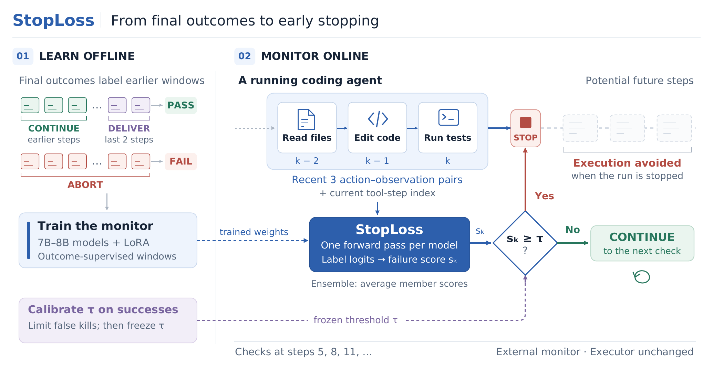
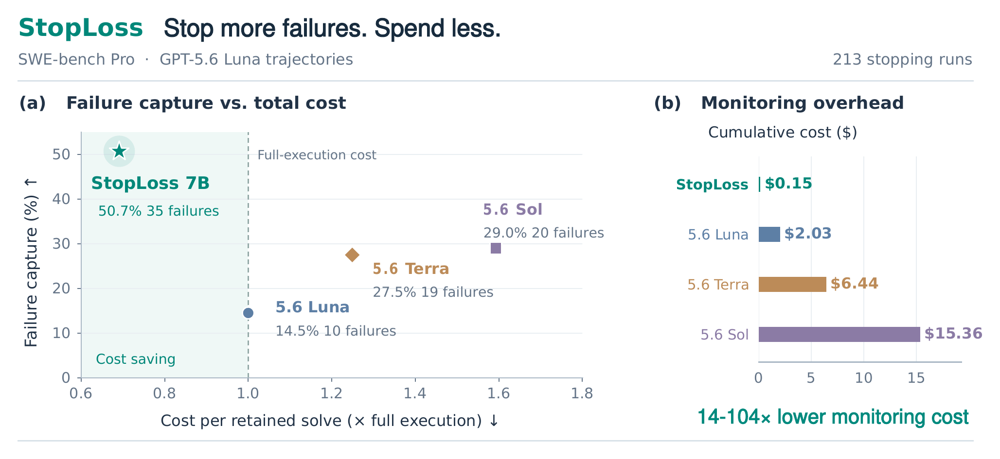

<div align="center">

# StopLoss

### Teaching Agents to Predict Failure and Stop Early

<!-- TODO: replace the X and LinkedIn links below with the announcement posts (also in homepage/index.html). -->
[](https://tiger-ai-lab.github.io/StopLoss/)
[](https://arxiv.org/abs/2610.25525)
[](https://huggingface.co/collections/TIGER-Lab/stoploss-6ad62c481a266ca21cefb54c)
[](https://x.com/TODO)
[](https://www.linkedin.com/TODO)
[](LICENSE)

</div>

## 🔔 News

- **[2026-10]** 🔥 Our paper is on [arXiv](https://arxiv.org/abs/2610.25525). The [homepage](https://tiger-ai-lab.github.io/StopLoss/), code, three trained monitors and the training data are released.

## Overview

Coding agents keep working on runs that will fail verification, and asking a frontier model to watch them is
expensive in its own right. **StopLoss** is a small external monitor that learns to recognize failure from completed
runs and ends a run early when it is likely to fail, like a stop-loss order in finance.

- **Learns from final outcomes.** The verifier outcome of each completed run labels the run's earlier windows, and a
  7–8B model is fine-tuned on these windows with LoRA. No step-level annotation is needed.
- **One forward pass per check.** At tool steps 5, 8, 11, …, the monitor reads the step count and the three most
  recent action–observation pairs and outputs the probability that the run will fail.
- **Leaves the agent unchanged.** A threshold calibrated on successful runs turns the score into a stop decision. The
  monitor only reads the trajectory text, so agents built on closed models can be monitored too.

<p align="center">
  
</p>

## Results

We train on SWE-rebench runs of GPT-5.6 Luna and Terra and evaluate on SWE-bench Verified and a SWE-bench Pro subset,
with GPT-5.6 Luna and Claude Sonnet 4.6 as executors. Six frontier LLM judges read the same windows as baselines, and
every method pays for its checks and for the successful runs it stops.

- **Cheap checks.** A check costs an estimated $0.00024 (primary ensemble), one to two orders of magnitude less than
  with any judge we tested.
- **Net savings.** On Verified with GPT-5.6 Luna, StopLoss keeps 99% of successful runs and lowers the cost per
  retained solve by 4.5%. On the costlier Pro subset the savings reach 31%, and 48% with a Qwen3-8B backbone.
- **Cheaper than every judge.** In all four settings, all three backbones have a lower cost per retained solve than
  every judge policy.

<p align="center">
  
  <br>
  <sub>SWE-bench Pro with GPT-5.6 Luna as the executor. StopLoss (Qwen2.5-Coder-7B-Instruct) stops 35 of the 69
  failing runs, while no judge stops more than 20, and spends $0.15 on monitoring across all 213 runs, versus
  $2.03–$15.36 for the judges.</sub>
</p>

**Table 1.** StopLoss has a lower estimated cost per retained solve than every LLM-judge policy, in all four settings
and with all three backbones.

<table>
  <thead>
    <tr>
      <th rowspan="2" align="left">Method</th>
      <th colspan="2" align="center">Cost ↓</th>
      <th align="center">Prediction&nbsp;↑</th>
      <th colspan="2" align="center">Stopping outcomes ↑</th>
    </tr>
    <tr>
      <th align="center">ΔCPS<br>(%)</th>
      <th align="center">Monitoring<br>($)</th>
      <th align="center">Tier<br>AUC</th>
      <th align="center">Success<br>retained (%)</th>
      <th align="center">Failure<br>capture (%)</th>
    </tr>
  </thead>
  <tbody>
    <tr><th colspan="6" align="left">SWE-bench Verified · GPT-5.6 Luna <sub>(425 runs: 306 successes, 119 failures)</sub></th></tr>
    <tr><td><b>StopLoss</b></td><td align="center">−4.5</td><td align="center">0.44</td><td align="center">0.622</td><td align="center"><b>99.0</b></td><td align="center">5.0</td></tr>
    <tr><td>&emsp;Qwen3-8B</td><td align="center">−1.8</td><td align="center">0.43</td><td align="center">0.605</td><td align="center">97.7</td><td align="center">5.0</td></tr>
    <tr><td>&emsp;Qwen2.5-Coder-7B-Instruct</td><td align="center"><b>−5.2</b></td><td align="center"><b>0.35</b></td><td align="center">0.612</td><td align="center"><b>99.0</b></td><td align="center">5.9</td></tr>
    <tr><td>GPT-5.6 Sol</td><td align="center">+116.8</td><td align="center">33.20</td><td align="center">0.633</td><td align="center">91.8</td><td align="center">20.2</td></tr>
    <tr><td>GPT-5.6 Terra</td><td align="center">+38.6</td><td align="center">12.90</td><td align="center">0.623</td><td align="center">89.5</td><td align="center"><b>24.4</b></td></tr>
    <tr><td>GPT-5.6 Luna</td><td align="center">+8.4</td><td align="center">4.18</td><td align="center">0.600</td><td align="center">90.8</td><td align="center">14.3</td></tr>
    <tr><th colspan="6" align="left">SWE-bench Verified · Claude Sonnet 4.6 <sub>(425 runs: 326 successes, 99 failures)</sub></th></tr>
    <tr><td><b>StopLoss</b></td><td align="center">+0.2</td><td align="center">0.44</td><td align="center">0.561</td><td align="center"><b>100.0</b></td><td align="center">0.0</td></tr>
    <tr><td>&emsp;Qwen3-8B</td><td align="center"><b>−1.1</b></td><td align="center">0.42</td><td align="center">0.563</td><td align="center">99.7</td><td align="center">2.0</td></tr>
    <tr><td>&emsp;Qwen2.5-Coder-7B-Instruct</td><td align="center">+0.1</td><td align="center"><b>0.35</b></td><td align="center">0.561</td><td align="center"><b>100.0</b></td><td align="center">0.0</td></tr>
    <tr><td>Claude Opus 5</td><td align="center">+34.7</td><td align="center">127.13</td><td align="center">0.747</td><td align="center">95.7</td><td align="center"><b>32.3</b></td></tr>
    <tr><td>Claude Opus 4.6</td><td align="center">+11.6</td><td align="center">37.07</td><td align="center">0.602</td><td align="center">99.1</td><td align="center">0.0</td></tr>
    <tr><td>Claude Sonnet 4.6</td><td align="center">+10.3</td><td align="center">37.97</td><td align="center">0.602</td><td align="center">97.5</td><td align="center">3.0</td></tr>
    <tr><th colspan="6" align="left">SWE-bench Pro · GPT-5.6 Luna <sub>(213 runs: 144 successes, 69 failures)</sub></th></tr>
    <tr><td><b>StopLoss</b></td><td align="center">−24.2</td><td align="center">0.20</td><td align="center">0.614</td><td align="center">72.2</td><td align="center">43.5</td></tr>
    <tr><td>&emsp;Qwen3-8B</td><td align="center">−25.7</td><td align="center">0.21</td><td align="center">0.621</td><td align="center">84.0</td><td align="center">37.7</td></tr>
    <tr><td>&emsp;Qwen2.5-Coder-7B-Instruct</td><td align="center"><b>−30.9</b></td><td align="center"><b>0.15</b></td><td align="center">0.620</td><td align="center">74.3</td><td align="center"><b>50.7</b></td></tr>
    <tr><td>GPT-5.6 Sol</td><td align="center">+59.3</td><td align="center">15.36</td><td align="center">0.657</td><td align="center">86.8</td><td align="center">29.0</td></tr>
    <tr><td>GPT-5.6 Terra</td><td align="center">+24.9</td><td align="center">6.44</td><td align="center">0.651</td><td align="center">79.2</td><td align="center">27.5</td></tr>
    <tr><td>GPT-5.6 Luna</td><td align="center">+0.0</td><td align="center">2.03</td><td align="center">0.639</td><td align="center"><b>87.5</b></td><td align="center">14.5</td></tr>
    <tr><th colspan="6" align="left">SWE-bench Pro · Claude Sonnet 4.6 <sub>(213 runs: 107 successes, 106 failures)</sub></th></tr>
    <tr><td><b>StopLoss</b></td><td align="center">−30.6</td><td align="center">0.30</td><td align="center">0.579</td><td align="center">91.6</td><td align="center">19.8</td></tr>
    <tr><td>&emsp;Qwen3-8B</td><td align="center"><b>−48.1</b></td><td align="center"><b>0.23</b></td><td align="center">0.608</td><td align="center">83.2</td><td align="center"><b>31.1</b></td></tr>
    <tr><td>&emsp;Qwen2.5-Coder-7B-Instruct</td><td align="center">−34.5</td><td align="center"><b>0.23</b></td><td align="center">0.578</td><td align="center">89.7</td><td align="center">19.8</td></tr>
    <tr><td>Claude Opus 5</td><td align="center">−26.5</td><td align="center">34.59</td><td align="center">0.695</td><td align="center">95.3</td><td align="center"><b>31.1</b></td></tr>
    <tr><td>Claude Opus 4.6</td><td align="center">−17.2</td><td align="center">23.98</td><td align="center">0.614</td><td align="center"><b>97.2</b></td><td align="center">15.1</td></tr>
    <tr><td>Claude Sonnet 4.6</td><td align="center">−29.0</td><td align="center">19.84</td><td align="center">0.598</td><td align="center">83.2</td><td align="center">23.6</td></tr>
  </tbody>
</table>

<sub>**ΔCPS**: change in cost per retained solve relative to running every task to completion, monitoring included
(negative values are savings). **Monitoring**: total cost of the monitor's checks. **Tier AUC**: how well failure
scores rank eventual failures above successes at similar spend (0.5 is chance). **Success retained** and **failure
capture**: share of otherwise successful runs kept and of otherwise failed runs stopped. Bold marks the best cost and
stopping values within a setting. **StopLoss** is the primary Qwen2.5-7B-Instruct ensemble (5 seeds); the indented rows
are the Qwen3-8B and Qwen2.5-Coder-7B-Instruct ensembles (4 seeds each). GPT-5.6 judges read GPT-5.6 Luna runs and
Claude judges read Claude Sonnet 4.6 runs; tier AUC uses every run with a verdict.</sub>

## Models and data

| Release | Hugging Face |
|:--|:--|
| Monitor · Qwen2.5-7B-Instruct (primary) | [🤗 TIGER-Lab/StopLoss-Qwen2.5-7B-Instruct](https://huggingface.co/TIGER-Lab/StopLoss-Qwen2.5-7B-Instruct) |
| Monitor · Qwen3-8B | [🤗 TIGER-Lab/StopLoss-Qwen3-8B](https://huggingface.co/TIGER-Lab/StopLoss-Qwen3-8B) |
| Monitor · Qwen2.5-Coder-7B-Instruct | [🤗 TIGER-Lab/StopLoss-Qwen2.5-Coder-7B-Instruct](https://huggingface.co/TIGER-Lab/StopLoss-Qwen2.5-Coder-7B-Instruct) |
| Training data | [🤗 TIGER-Lab/StopLoss-Training-Data](https://huggingface.co/datasets/TIGER-Lab/StopLoss-Training-Data) |

The monitors are LoRA adapters, each seed 0 of its backbone; the paper reports ensembles of 5, 4 and 4 seeds. The
training data hold the windows the monitors are trained on (`train.jsonl`, from SWE-rebench runs) and the
checkpoint-selection set (`validation.jsonl`).

## Getting started

### Installation

```bash
git clone https://github.com/TIGER-AI-Lab/StopLoss.git && cd StopLoss
pip install -e ".[model]"
```

`.[model]` adds PyTorch, transformers and peft for window building, training and scoring. The base package
(`pip install -e .`) is enough for the evaluation and the LLM judges; add `.[collect]` for trajectory collection and
`.[dev]` for the tests (`pytest`).

### Score your runs with a released monitor

A run record is one JSON line per finished run with `task`, `bench`, `worker`, `reward` (1 solved, 0 failed) and
`trajectory`, the path of Harbor's `agent/trajectory.json`.

```bash
# windows at the checks k = 5, 8, 11, ...
python scripts/build_windows.py --runs my_runs.jsonl --out windows.jsonl --ks checkpoints

# probability of failure for every window, one forward pass each
python scripts/score_windows.py --base Qwen/Qwen2.5-7B-Instruct \
    --adapter TIGER-Lab/StopLoss-Qwen2.5-7B-Instruct \
    --windows windows.jsonl --out scores.jsonl
```

### Train a monitor

```bash
hf download TIGER-Lab/StopLoss-Training-Data --repo-type dataset --local-dir data/stoploss
python training/train.py --recipe training/recipes/qwen2.5-7b-instruct.json \
    --data data/stoploss/train.jsonl --val-data data/stoploss/validation.jsonl \
    --out runs/qwen2.5-7b-instruct_s0 --seed 0
```

This takes about 14.5 hours on one 48 GB GPU and saves the selected checkpoint to `best/` in the output folder.
`training/run_seeds.sh` trains every seed of a recipe; the Qwen3-8B and Qwen2.5-Coder-7B-Instruct recipes use two
GPUs.

## Reproducing the paper

| Step | Entry point | Settings |
|:--|:--|:--|
| 1. Collect trajectories (Harbor, Terminus-2) | `scripts/collect_trajectories.py` | `configs/executors.json` |
| 2. Build labelled windows | `scripts/build_windows.py` | |
| 3. Train the monitors | `training/train.py` | `training/recipes/` |
| 4. Score windows | `scripts/score_windows.py` | |
| 5. Run the LLM judges | `scripts/run_judge.py` | `configs/judges.json` |
| 6. Calibrate, replay and evaluate | `scripts/evaluate.py` | `configs/evaluation_example.json` |

Every script describes its inputs and outputs in `--help`.

<details>
<summary>Repository layout</summary>

```
stoploss/                 the library
  windows.py              trajectory -> (action, observation) pairs -> labelled windows within a token budget
  sequence.py             chat-template encoding shared by builder, trainer and scorer; answer-token readout
  score.py                failure scores (BF16 forward, FP32 softmax) and GPU time per check
  judges/                 judge prompt and parser, OpenAI / Anthropic clients, scoring runner, call ledger
  collect/                metering gateway, call ledger, Harbor Terminus-2 runner
  costs.py                frozen list prices, ledger-to-step alignment, per-step execution spend
  policy.py               checkpoints, threshold calibration, stopping replay, cost per retained solve
  metrics.py              AUC and tier AUC
  bootstrap.py            repository-cluster bootstrap shared across methods
  evaluate.py             evaluation of one setting (ranking, stopping, intervals, fixed-checkpoint AUC)
training/                 monitor training: train.py, run_seeds.sh and one recipe per backbone
scripts/                  command-line entry points of the other steps
configs/                  prices, judge and executor settings, an example evaluation spec
tests/                    unit tests on synthetic data (no network, no GPU)
homepage/                 project page, published to GitHub Pages by .github/workflows/pages.yml
```

</details>

## Citation

If you find StopLoss useful, please cite our paper:

<!-- TODO: replace this placeholder with the Google Scholar BibTeX once the paper is indexed (also in homepage/index.html). -->
```bibtex
@article{stoploss2026,
  title   = {StopLoss: Teaching Agents to Predict Failure and Stop Early},
  author  = {TBD},
  journal = {arXiv preprint arXiv:2610.25525},
  year    = {2026}
}
```

## License

The code is released under the [MIT License](LICENSE).
